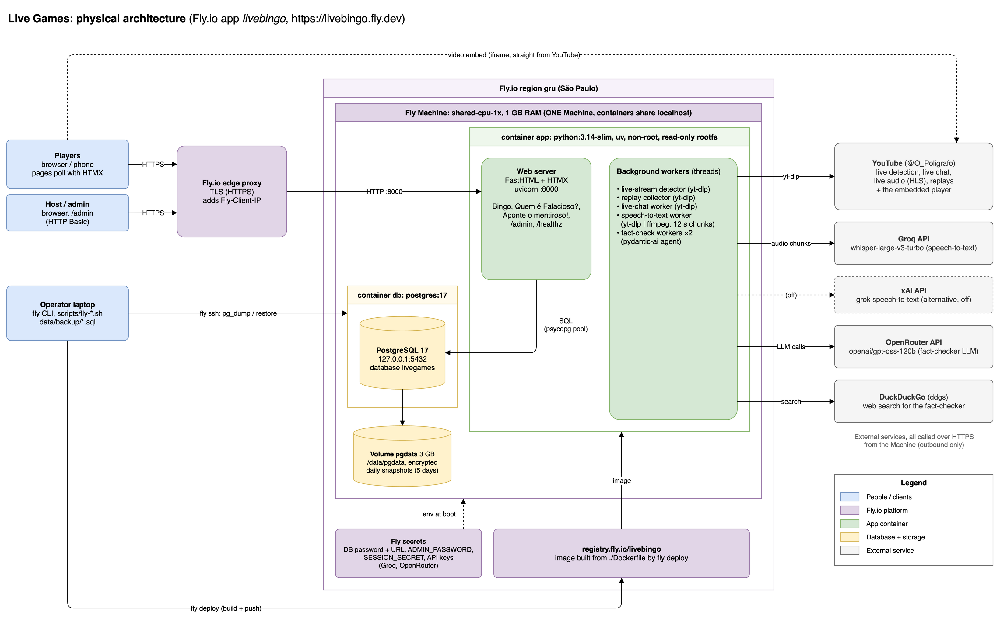

# Live Games: architecture (current state, 2026-10-26)

What runs where, which parts talk to which, and where the data lives. Operations (backup, restore, deploy, start/stop):
`docs/operations.md`. Open work: `docs/backlog.md`. Validation history per area: `docs/validation/*.md`.
The original v2 design (`docs/design.md`) and the fact-checker plan (`docs/fact-checker-plan.md`) are kept for history; where
they disagree with this file, this file is right.

## The product
Three pt-BR games played on a phone or a browser while the YouTube channel @O_Poligrafo streams. The host (admin) starts ONE
session on /admin that opens the three games together, on one video (a live stream or a recorded replay), and ends them together.

| Game | URL | In one line |
|---|---|---|
| Bingo | `/` | A 4x4 card of phrases from past streams; players tap what they hear; most marks when the host ends the game wins. |
| Falaciômetro (`falacias`) | `/falacias` | Transcript + chat panes follow the video; players select a passage and name the fallacy; the host reviews (Correto / Errado / Spam). |
| Verdade ou Lorota (`checker`) | `/checker` | Players pick or type a claim and guess its score from -5 to +5; an AI fact-checker (or the host) gives the real score. |

## Physical architecture

Source: `docs/diagrams/physical-architecture.drawio` (open in draw.io; the PNG also embeds the editable diagram). It is generated by
`docs/diagrams/make_physical.py`: edit the script, run `python3 docs/diagrams/make_physical.py`, then re-export (commands at the end).

- **One Fly Machine** (`livebingo`, region gru, shared-cpu-1x, 1 GB) runs **two containers** that share localhost:
  `app` (our image) and `db` (postgres:17, listening on 127.0.0.1 only). Deploys are ALWAYS `fly deploy --ha=false`: the volume
  belongs to one Machine. Config: `fly.toml` + `deploy/fly.machine.json`.
- **Fly's edge proxy** terminates TLS and forwards HTTP to the app on port 8000. The client IP comes from the `Fly-Client-IP`
  header (`CLIENT_IP_HEADER=fly-client-ip`), used by the players-per-network limit.
- **Data** lives on the volume `pgdata` (3 GB, encrypted, `/data/pgdata`). Fly snapshots it daily (kept 5 days). Our own backups are
  plain SQL dumps on the operator's laptop (`scripts/fly-db-backup.sh`).
- **Secrets** are Fly secrets. A container only receives the ones listed under its `secrets` in `deploy/fly.machine.json`.
- **Outbound only**: the app calls YouTube (yt-dlp), Groq (speech-to-text), OpenRouter (fact-checker model) and DuckDuckGo (search)
  over HTTPS. Nothing calls into the app except through the proxy. Players' browsers load the video player straight from YouTube.

## Inside the app container

One Python process: `uvicorn app.main:app` (FastHTML + HTMX, server-rendered HTML, no JS framework). On boot
`docker/entrypoint.sh` applies the SQL migrations, seeds phrases / fallacies / the demo replay ONLY into EMPTY tables, then starts uvicorn.

Pages update by **polling** (HTMX `hx-trigger="every Ns"`); an unchanged answer is a 204 so nothing is redrawn:
- players: the Bingo card every 5 s, the Falácias / checker feeds every 2 s, side panels and score lines every 5 s;
- admin: Bingo users table + cards every 5 s, the Falácias queue and checker panel every 3 s.

Background work runs in **daemon threads of the same process** (no queue server; the database is the queue):

| Worker | Module | Starts | Talks to | Writes |
|---|---|---|---|---|
| Live-stream detector | `app/livestream.py` | on boot, refreshed in the background (~10-15 s per lookup) | YouTube (yt-dlp) | memory cache |
| Replay collector | `app/replaycollector.py` | on boot (`REPLAY_COLLECTOR=off` disables) | YouTube (yt-dlp: captions + chat replay) | `replays`, `replay_events` |
| Live-chat worker | `app/chatworker.py` | on demand, while a game follows a LIVE stream | YouTube (yt-dlp live_chat) | `stream_events` (chat) |
| Speech-to-text worker | `app/sttworker.py` | on demand, with the chat worker, if `STT_PROVIDER` is set | YouTube audio (yt-dlp, ffmpeg 12 s chunks) -> Groq | `stream_events` (transcript) |
| Fact-check workers (2) | `app/checkworker.py` + `app/factcheck.py` | on boot, if `CHECKER_MODEL` and its key are set | OpenRouter (LLM) + DuckDuckGo (search) | `fact_checks` |

The fact-checker is a pydantic-ai agent in two steps: research (the model searches the web) then answer (verdict, score -5..+5,
confidence, sources). Low confidence or "unverifiable" goes to the host's queue. The host's score always wins for the points, and it
never stops the AI from running (migration 0014).

### Code map
| Area | Modules |
|---|---|
| Web + pages | `app/main.py` (Bingo, app wiring), `app/falacias_web.py`, `app/checker_web.py`, `app/ui.py`, `app/scorebar.py`, `app/texts.py` (all pt-BR strings), `app/static/` |
| Admin | `app/admin_web.py` (shell, Bingo, session start/end), `app/falacias_admin_web.py`, `app/checker_admin_web.py`, `app/phrases_web.py`, `app/fallacies_web.py`, `app/admin.py` (auth + read model) |
| Game rules (no web code) | `app/sessions.py`, `app/globalsession.py`, `app/cards.py`, `app/marks.py`, `app/scoring.py`, `app/phrases.py`, `app/falacias.py`, `app/checker.py`, `app/host_messages.py`, `app/fallacies_admin.py` |
| Feed (transcript + chat) | `app/feed.py`, `app/replays.py`, `app/replaycollector.py`, `app/chatworker.py`, `app/sttworker.py`, `app/livestream.py` |
| Database | `app/db.py` (pool, migrations runner), `migrations/0001..0014_*.sql` (the source of truth for the schema) |
| Corpus (offline, CLI) | `corpus/` (`uv run corpus fetch / suggest / rescore / load / replay-import ...`) |
| Deploy | `Dockerfile`, `docker/entrypoint.sh`, `docker-compose.yml`, `fly.toml`, `deploy/`, `scripts/` |

## Data model (PostgreSQL 17, 16 tables)
Migrations in `migrations/` are the truth (`\d <table>` in psql). Summary by area:

| Area | Tables | Notes |
|---|---|---|
| Sessions + players | `game_sessions`, `users`, `app_settings` | one ACTIVE session per game (`game_type` bingo / falacias / checker); a player has one `users` row per session; only the sha256 of the cookie token is stored |
| Bingo | `phrases`, `bingo_cards`, `bingo_marks` (+ `confirmed_at`), `revoked_marks`, `kicked_players`, `confirmed_phrases`, `bingo_keywords`, `swap_rights` | cards are immutable except inside a keyword card swap (`app/swaps.py`); the host reviews marks PER PHRASE for all players (Correto = locked, also later marks; Incorreto = cleared everywhere), picks up to 3 secret keywords (a confirmed keyword mark earns one card swap), can unmark + block a cell and kick a player (user + card deleted, cookie hash kept for the notice); phrase scores are relearned at each game end |
| Feed | `replays`, `replay_events`, `stream_events` | replay = recorded video (captions + chat, text only); stream = live chat + speech-to-text lines |
| Falaciômetro | `fallacies`, `fallacy_marks`, `host_messages` | a mark = passage + fallacy; points derived from status and latency, never stored |
| Verdade ou Lorota | `fact_checks`, `fact_claims` | one check per distinct claim text per session; `status` = the AI pipeline (queued, running, done, needs_admin), the host's decision = `resolved_at` + `admin_score` |
| Bookkeeping | `schema_migrations` | applied migration file names |

Rules that the database enforces (CHECKs, unique and partial indexes, triggers) are listed in AGENTS.md under "Domain rules".

## Configuration (environment)
Read from the environment; locally also from `.env` (never committed). In the cloud, plain values sit in `deploy/fly.machine.json`
and secret ones are Fly secrets.

| Variable | Used for | Cloud value |
|---|---|---|
| `DATABASE_URL`, `POSTGRES_PASSWORD` | database connection | secrets |
| `ADMIN_PASSWORD` | HTTP Basic for /admin | secret |
| `SESSION_SECRET` | signed cookies | secret |
| `COOKIE_SECURE`, `CLIENT_IP_HEADER`, `TRUSTED_PROXIES` | HTTPS cookies, real client IP | `1`, `fly-client-ip` |
| `MAX_USERS_PER_IP` | players per network (also editable on /admin) | `3` |
| `TIMEZONE` | times shown to people | `America/Sao_Paulo` |
| `STT_PROVIDER`, `STT_LANGUAGE`, `GROQ_API_KEY` / `XAI_API_KEY` | speech-to-text (`groq`, `grok`, `whispercpp`, empty = off) | `groq`, `pt` |
| `CHECKER_MODEL`, `CHECKER_WORKERS`, `OPENROUTER_API_KEY` / `GROQ_API_KEY` | fact-checker (`openrouter:<id>` or `groq:<id>`, empty = off) | `openrouter:openai/gpt-oss-120b`, 2 |
| `REPLAY_COLLECTOR`, `REPLAY_MAX_HOURS`, `LIVE_CHANNEL_URL`, `LIVE_VIDEO_ID`, `POOL_MAX` | tuning / overrides | defaults |

## Local development
`docker compose up -d db` runs only Postgres (published on 127.0.0.1:5432 by `docker-compose.override.yml`), and the app runs on the
host with `uv run uvicorn app.main:app --reload`. `docker compose -f docker-compose.yml up -d --build` runs the production-like pair
(app + db) for smoke tests. Tests: `uv run pytest` (each run makes its own `livegames_test_*` database).

## Known limits (be critical)
- **One Machine**: no redundancy; a deploy or a crash interrupts games for 10-30 s (data is safe, players reconnect by themselves).
- **Threads in the web process**: a stuck worker shares CPU and memory with the pages; there is no separate worker process to scale.
- **Polling, not push**: simple and robust behind Fly's proxy, but every open page costs a request every 2-5 s.
- **Free web search** (DuckDuckGo via ddgs) throttles bursts; failed checks are retried, then go to the host.
- **yt-dlp from a datacenter IP** can be blocked by YouTube at any time; the live chat / audio workers then report "down".
- **Backups are manual** and on one laptop (plus Fly's 5-day volume snapshots).

## Regenerating the diagram
    python3 docs/diagrams/make_physical.py                                    # -> docs/diagrams/physical-architecture.drawio
    drawio -x -f png -e -s 2 -b 10 -o docs/diagrams/physical-architecture.drawio.png docs/diagrams/physical-architecture.drawio
    python3 ~/.hermes/skills/drawio-skill/scripts/repair_png.py docs/diagrams/physical-architecture.drawio.png   # fixes draw.io's PNG ending
